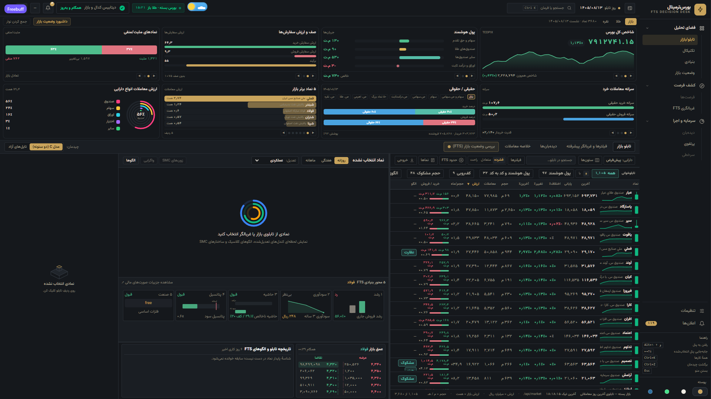
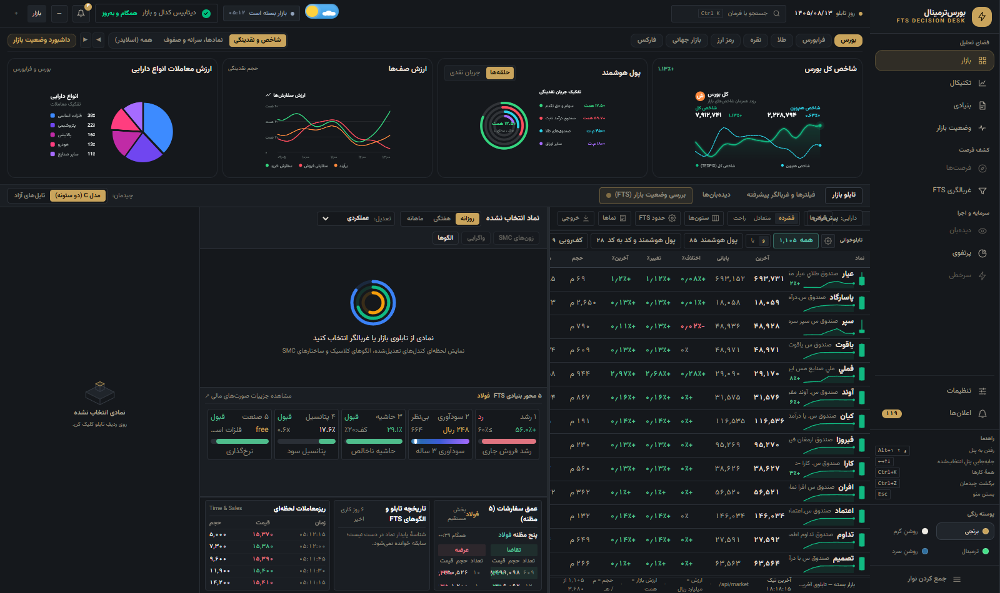
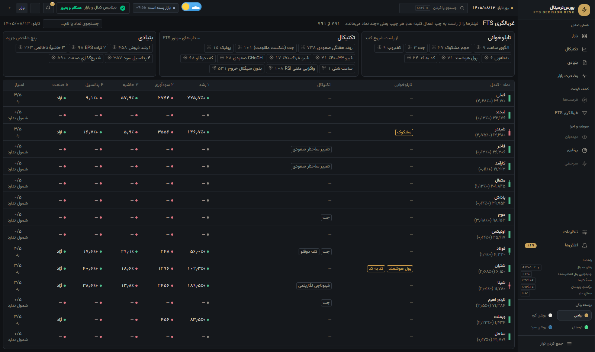
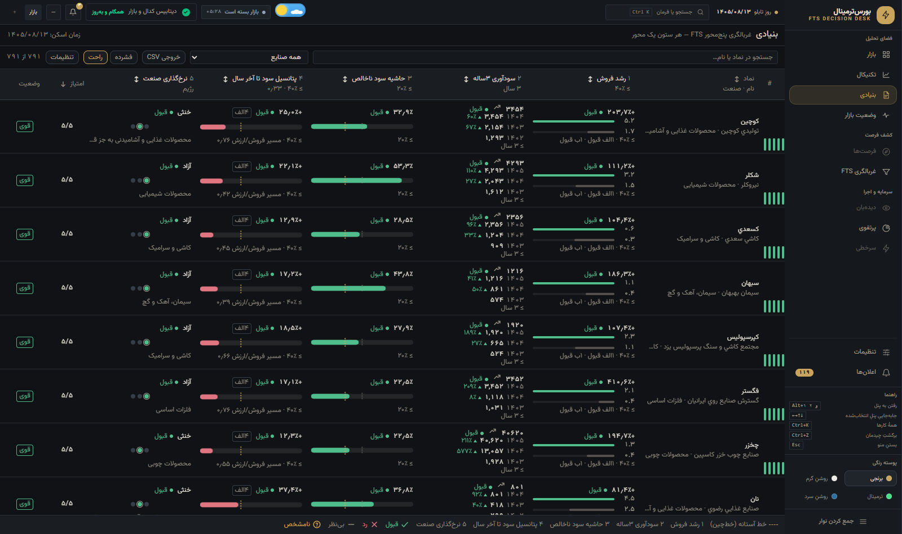
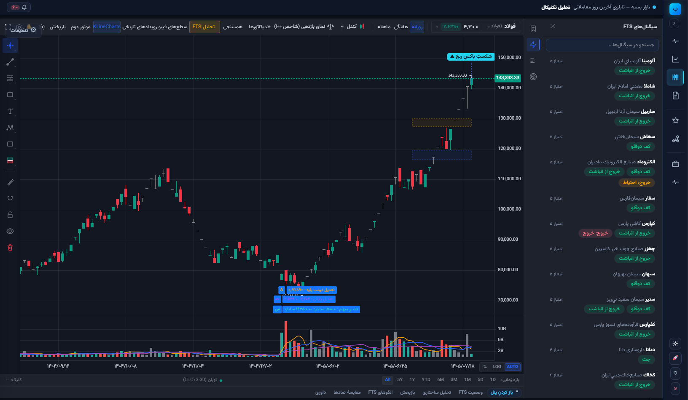
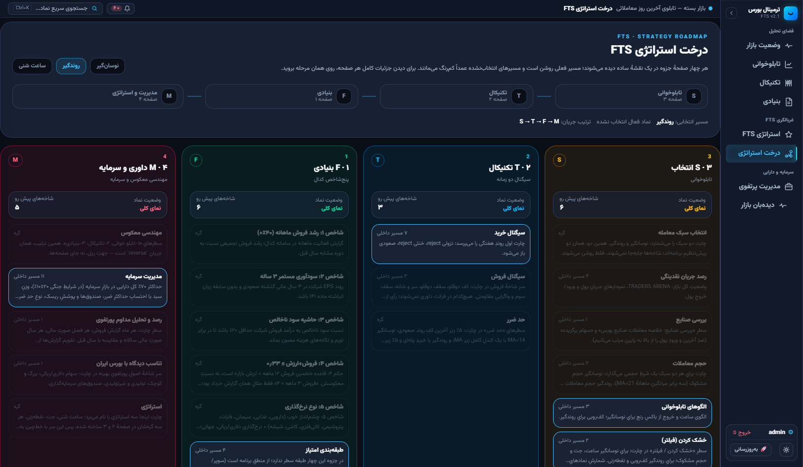

# BorsTerminal

  

  <b>ایستگاه معاملاتی، تحلیلی و پژوهشی دسکتاپ برای بازار سرمایه ایران (بورس تهران)</b> 
  <b>High-Performance Desktop Trading, Technical & Fundamental Research Workstation for Iran's Capital Market</b>

  
  
  
  
  

---

## معرفی پروژه (Overview)

**BorsTerminal** یک سکوی جامع، بومی و با عملکرد بالا برای تحلیل‌گران، معامله‌گران و پژوهشگران بازار سرمایه است که با معماری مدرن **Local-First** پیاده‌سازی شده است. این نرم‌افزار پایش زنده بازار، تابلوخوانی پیشرفته، غربالگری چندمحوره بر اساس روش‌شناسی FTS، تحلیل بنیادی داده‌های کدال، تحلیل تکنیکال نمودارهای تعدیل‌شده و مدیریت منابع تحلیلی را در یک محیط یکپارچه دسکتاپ فراهم می‌کند.

این مخزن **ویترین عمومی (Public Showcase)** پروژه است. کد منبع هسته، فایل‌های نصاب، مدل‌های ریاضی و داده‌های اختصاصی در این مخزن منتشر نمی‌شوند.

---

## گالری و نماهای برنامه (Visual Showcase)

### ۱. نمای سراسری بازار و تابلوخوانی (Market Overview & Live Board)
پایش بلادرنگ صف‌های خرید و فروش، قدرت خریدار و فروشنده، فیلترهای جریان پول هوشمند، کد به کد، حجم مشکوک و نقشه پویای صنایع.

  

---

### ۲. ریبون هوشمند بازار و رصد سرمایه خرد (Market Top Ribbon & Retail Flow)
نمایش برخط شاخص‌های کل و هم‌وزن، طلا و ارز، خلاصه ۹ دسته معاملات خرد، تفکیک حقیقی/حقوقی و روندهای درون‌روزی ارزش سفارش‌ها و سرانه.

  

---

### ۳. غربالگری ده‌ستونه FTS با ریزنمودارها (10-Column FTS Screener)
غربالگری جامع نمادها بر اساس شاخص‌های روش FTS، وضعیت الگوهای تکنیکال، فازهای پنج‌گانه بنیادی و مینی‌چارت‌های روند درون جدول با سرعت رندر فوق‌العاده.

  

---

### ۴. ارزیابی ساختاری و بنیادی شرکت‌ها (Fundamental Analysis & Codal Data)
تحلیل چندمحوره سلامت و رشد شرکت‌ها بر مبنای صورت‌های مالی کدال، گزارش‌های فروش ماهانه، روند فصلی EPS، رژیم نرخ‌گذاری و کشف پتانسیل سودآوری.

  

---

### ۵. نمودار تکنیکال پیشرفته (Advanced Technical KLine Chart)
نمودار روان مبتنی بر KLine با محاسبه آنی تعدیل عملکردی و سرمایه (Parity با ره‌آورد)، انواع اندیکاتورهای تراز اول، ابزارهای ترسیم و اورلی‌های خودکار FTS.

  

---

### ۶. درخت استراتژی و فلوچارت تصمیم‌گیری (FTS Strategy Tree & Decision Graph)
نمایش گرافیکال و پویای جریان تصمیم‌گیری (نوسان‌گیر، روندگیر، سرمایه‌گذار)، پیگیری علت‌های رد یا پذیرش هر نماد و سناریوهای مدیریت ریسک و خروج.

  

---

## قابلیت‌های کلیدی (Core Capabilities)

- **تابلوخوانی پیشرفته (Advanced Tape Reading):**
  - فیلترهای استاندارد کف‌روبی، الگوی ساعت، حجم‌های مشکوک، ورود پول هوشمند، فیلتر جت و کد به کد.
  - تفکیک سرانه خرید و فروش حقیقی، قدرت خریدار و پایش لحظه‌ای صف‌ها.
  - نقشه بازار تعاملی با دسته‌بندی بر اساس صنعت و ارزش معاملات.

- **تحلیل تکنیکال بومی و سریع (High-Fidelity Technical Analysis):**
  - موتور تعدیل دقیق قیمت (افزایش سرمایه و سود نقدی DPS) با همگامی کامل با مراجع بازار.
  - شاردهای تکنیکال فشرده برای بارگذاری سریع صدها نماد بدون نیاز به ارتباط دائمی با اینترنت.
  - تشخیص الگوهای کلاسیک، نواحی عرضه و تقاضا، سطوح فیبوناچی و تغییر فازهای روند.

- **غربالگری و روش‌شناسی FTS (FTS Screening Methodology):**
  - اجرای قیف‌های مرحله‌به‌مرحله: تابلوخوانی $\rightarrow$ تکنیکال $\rightarrow$ بنیادی.
  - شفافیت کامل در دلایل وتو یا پذیرش هر نماد و ارائه شاخص‌های قابل‌اندازه‌گیری.

- **پایش بنیادی و داده‌های کدال (Fundamental Analysis):**
  - واکشی و دسته‌بندی گزارش‌های رسمی سامانه کدال (گزارش‌های فعالیت ماهانه، صورت‌های مالی ۳، ۶، ۹ و ۱۲ ماهه).
  - محاسبه روند رشد فروش، حاشیه سود و بررسی انحراف از اهداف عملیاتی شرکت‌ها.

- **مدیریت کانال‌های تلگرام با حفظ حریم خصوصی (Telegram Channels Hub):**
  - امکان معرفی و همگام‌سازی کانال‌های عمومی تلگرام به صورت کاملاً محلی.
  - دریافت افزایشی پست‌ها با قابلیت پشتیبانی از خوانش مستقیم یا پراکسی شخصی Google Apps Script.
  - تفکیک کامل از داده‌های بازار و حفظ کامل امنیت و حریم خصوصی بدون ارسال هیچ‌گونه اطلاعات به سرورهای ثالث.

- **معماری مدرن و نصاب بهینه (Modern Architecture & Lean Distribution):**
  - پوسته سبک دسکتاپ بر پایه **Tauri 2** با کمترین مصرف حافظه رم و پردازنده.
  - بک‌اند مستقل و بهینه به زبان **Go (`borsd`)** برای محاسبات ریاضی سنگین و مدیریت دیتابیس‌های SQLite.
  - نصاب بهینه (Lean Setup) همراه با بسته‌های داده امضاشده مستقل با رمزنگاری `minisign`.

---

## اصول و استانداردهای طراحی (Design Principles)

1. **Local-First & Data Sovereignty:** تمام محاسبات، تحلیل‌ها و دیتابیس‌ها مستقیماً روی رایانه کاربر اجرا می‌شوند؛ هیچ وابستگی به سرویس‌های ابری اشتراکی وجود ندارد.
2. **Deterministic & Canonical Logic:** محاسبات ریاضی و منطق غربالگری دقیق و قطعی هستند و به حدسیات غیرشفاف واگذار نمی‌شوند.
3. **High Performance & Low Latency:** استفاده از ترکیب Go و کدهای بهینه شده TypeScript باعث می‌شود رابط حتی با هزاران ردیف بازار بدون لگ و با نرخ فریم بالا رندر شود.
4. **Privacy-Respecting:** اطلاعات و رفتارهای معاملاتی کاربر ذخیره نمی‌شوند و به هیچ سرور خارجی ارسال نمی‌گردند.

---

## مسیر توسعه (Development Roadmap)

جهت‌گیری‌های آینده پروژه در سند [ROADMAP.md](ROADMAP.md) تشریح شده است. اولویت‌های جاری شامل تثبیت معماری توزیع بسته داده، توسعه Opportunity Lab و ارتقای ابزارهای پایش پرتفوی می‌باشد.

---

## مالکیت فکری و شرایط استفاده (Intellectual Property)

این پروژه یک نرم‌افزار اختصاصی و تجاری است. مشاهده این مخزن ویترینی صرفاً جهت آشنایی با قابلیت‌ها و رویکرد مهندسی پروژه بوده و مجوزی برای بازتولید، مهندسی معکوس، توزیع مجدد یا استفاده تجاری از کدها و دارایی‌های BorsTerminal ایجاد نمی‌کند. کلیه حقوق محفوظ است.

---

## English Summary

**BorsTerminal** is an advanced desktop workstation designed specifically for the Tehran Stock Exchange (TSE). Built with a local-first philosophy, it combines:

- **Ultra-fast Market Monitoring:** Real-time order book analysis, smart money flow, per-capita power, and sector heatmaps.
- **Deterministic FTS Screening:** Multi-stage filtering methodology integrating tape reading, technical indicators, and fundamental metrics.
- **Precision Technical Charting:** KLine-based charting with exact capital-increase and cash-dividend (DPS) price adjustment parity.
- **In-depth Fundamental Analytics:** Automated ingestion and tracking of CODAL financial statements and monthly sales.
- **Private Telegram News Hub:** Secure, local-only public Telegram channel reader.
- **Modern Architecture:** Powered by **Tauri 2**, a dedicated high-throughput **Go (`borsd`)** backend, and a reactive **React/Vite** frontend on local SQLite stores.
